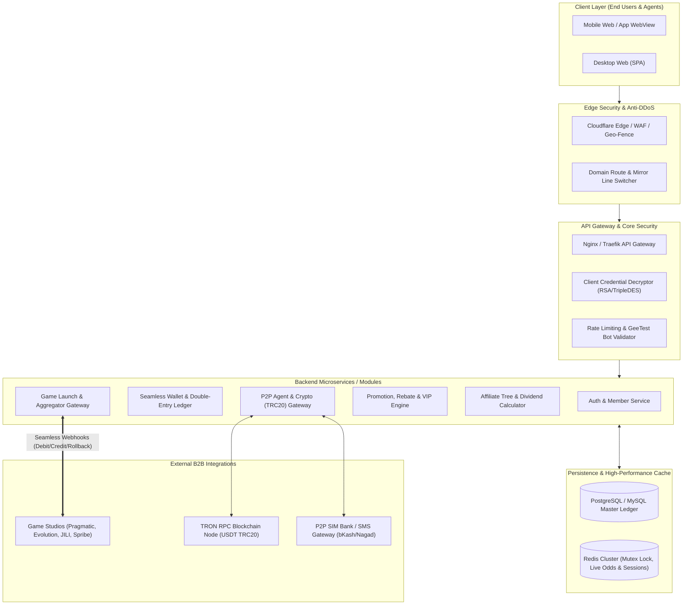
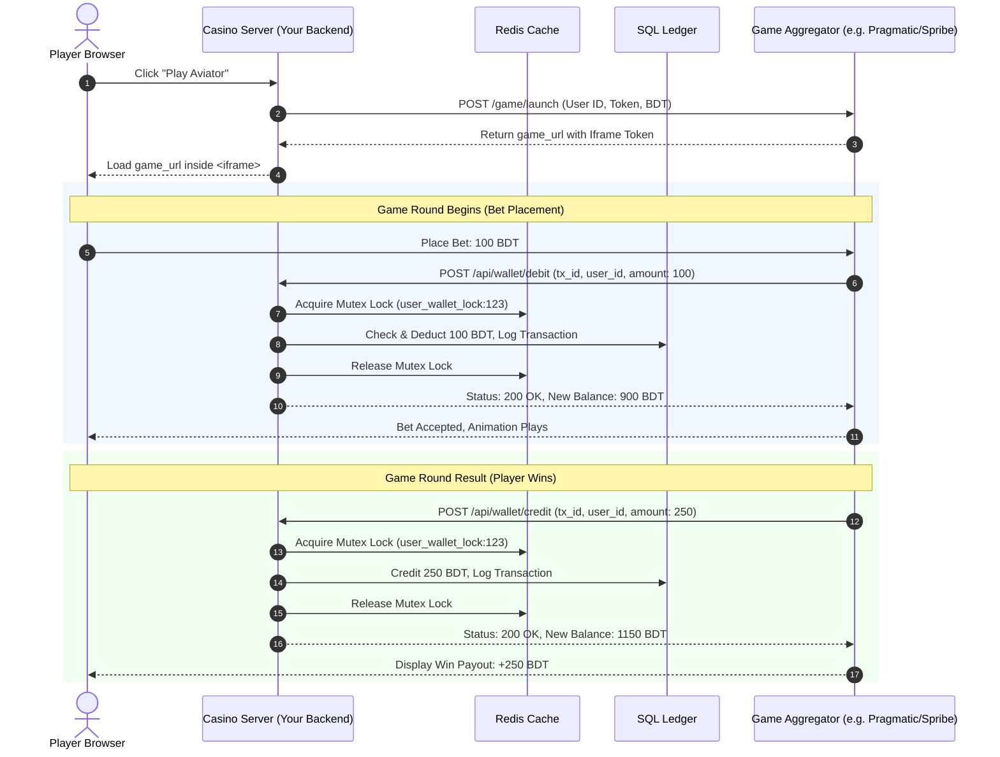
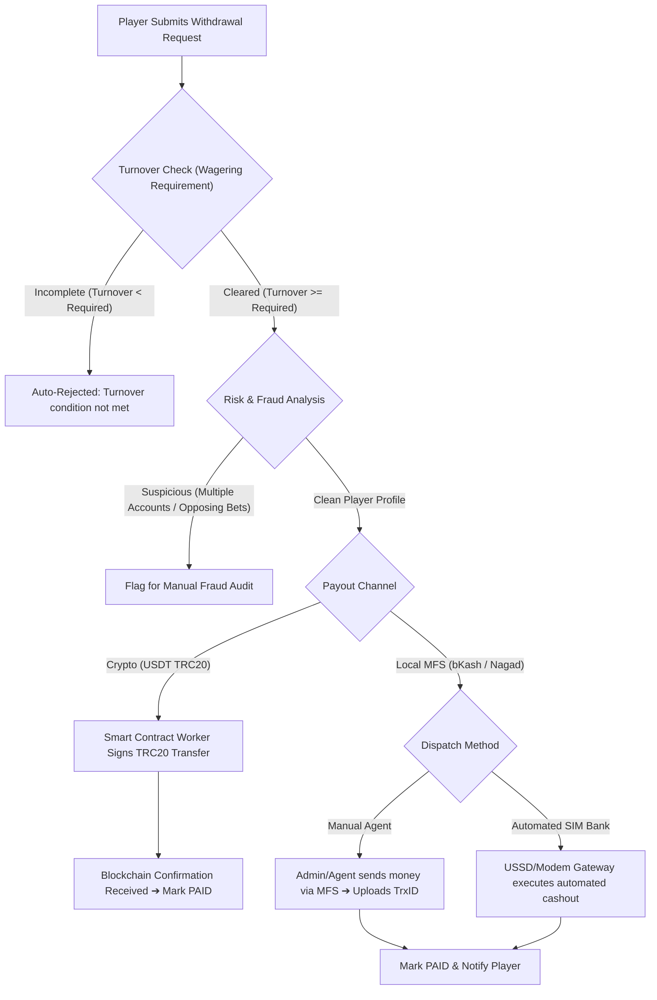

# 🏗️ iGaming Platform Architecture & System Specification
> **Platform Reference:** Reverse-Engineered Technical Blueprint based on CK44.nl (TCG White-label Engine)  
> **Target Audience:** Lead Software Architects, Backend Engineers & DevOps Teams  
> **Classification:** High-Concurrency Fintech & Gaming Aggregator System

---

## 1. Executive Summary & Platform Overview

The examined platform (**CK44**) is a localized, high-concurrency **iGaming, Casino, and Sportsbook Aggregator Platform** targeted at South Asian (specifically Bangladeshi) demographics.

### Core Architectural Reality
* **Frontend:** Single Page Application (Vue.js 2.7 / Webpack Chunked) wrapped with mobile-first CSS, aggressive promotional modal stacks, and client-side asymmetric cryptography (RSA + TripleDES).
* **Game Delivery:** The platform does **not** host game assets or game logic. It acts as an **Iframe Host & Wallet Controller** connecting to external Game Providers via a **Unified Seamless Wallet Protocol**.
* **Financial Ledger:** Operates a high-throughput, double-entry transaction database managing real cash, promotional bonus balances, turnover tracking, and multi-tier affiliate dividends.
* **Payments:** Bypasses conventional banking through P2P agent networks (bKash, Nagad, Rocket) and automated blockchain settlement (USDT TRC20 smart contracts).

---

## 2. High-Level System Topology



---

## 3. Frontend & Client-Side Cryptography

### Technology Stack
* **Framework:** Vue.js 2.7 with Vuex state store and Vue-Router.
* **UI Components:** Customized `tcg-web-view` UI toolkit, Swiper.js, Vue-Seamless-Scroll.
* **Device Detection (`aboutMerchant.js`):**  
  Automated detection parses User-Agent headers and URL parameters. If mobile, redirects traffic to `/m/index.html` or `/m/register` preserving `affiliateCode` and `referralCode` in `localStorage`.

### Asymmetric Client-Side Encryption (`encrypt.js`)
To prevent credential eavesdropping in transit (even before TLS), user input strings undergo client-side encryption:
1. **RSA Key Pair:** Public modulus ($M$) and exponent ($E$) are injected into the runtime.
2. **BigInt & Barrett Reduction:** Custom arithmetic handles multi-precision modular exponentiation.
3. **TripleDES / AES Fallback:** Data blocks are salted, encrypted, and Base64-encoded before transmitting to `/wps/session/login` or `/wps/member/register`.

---

## 4. Seamless Wallet Protocol Specification

The platform utilizes a **Seamless Wallet Architecture**, eliminating the traditional need for users to manually transfer money between "Main Wallet" and "Game Providers".



### Core API Contracts Required from Backend:
1. **`GetBalance` (`POST /api/wallet/balance`):**
   * Returns current real-time wallet balance.
2. **`Debit / Bet` (`POST /api/wallet/debit`):**
   * Atomically locks wallet, checks `balance >= bet_amount`, debits amount, records round ID.
3. **`Credit / Win` (`POST /api/wallet/credit`):**
   * Atomically credits payout amount to user's wallet.
4. **`Rollback` (`POST /api/wallet/rollback`):**
   * Reverses a prior debit if the game provider experiences network drops or server faults. Must be strictly **Idempotent**.

---

## 5. Relational Database Schema (Core Ledger)

```sql
-- 1. Users Master Table
CREATE TABLE users (
    id BIGSERIAL PRIMARY KEY,
    username VARCHAR(50) UNIQUE NOT NULL,
    password_hash VARCHAR(255) NOT NULL,
    mobile VARCHAR(20) UNIQUE,
    affiliate_id BIGINT REFERENCES users(id),
    status VARCHAR(20) DEFAULT 'ACTIVE', -- ACTIVE, SUSPENDED, BANNED
    created_at TIMESTAMP WITH TIME ZONE DEFAULT CURRENT_TIMESTAMP
);

-- 2. Multi-Balance Wallet Table
CREATE TABLE wallets (
    id BIGSERIAL PRIMARY KEY,
    user_id BIGINT NOT NULL REFERENCES users(id) ON DELETE CASCADE,
    currency VARCHAR(10) DEFAULT 'BDT',
    real_balance DECIMAL(16, 4) NOT NULL DEFAULT 0.0000,
    bonus_balance DECIMAL(16, 4) NOT NULL DEFAULT 0.0000,
    wagering_required DECIMAL(16, 4) NOT NULL DEFAULT 0.0000,
    wagering_completed DECIMAL(16, 4) NOT NULL DEFAULT 0.0000,
    version INT NOT NULL DEFAULT 1 -- Optimistic Locking
);

-- 3. Double-Entry Game Transaction Log
CREATE TABLE game_transactions (
    id BIGSERIAL PRIMARY KEY,
    tx_id VARCHAR(100) UNIQUE NOT NULL, -- Idempotency key from game provider
    user_id BIGINT NOT NULL REFERENCES users(id),
    provider_id VARCHAR(50) NOT NULL,
    game_code VARCHAR(50) NOT NULL,
    round_id VARCHAR(100) NOT NULL,
    type VARCHAR(20) NOT NULL, -- DEBIT, CREDIT, ROLLBACK
    amount DECIMAL(16, 4) NOT NULL,
    balance_before DECIMAL(16, 4) NOT NULL,
    balance_after DECIMAL(16, 4) NOT NULL,
    created_at TIMESTAMP WITH TIME ZONE DEFAULT CURRENT_TIMESTAMP
);

-- 4. Deposits Table
CREATE TABLE deposits (
    id BIGSERIAL PRIMARY KEY,
    user_id BIGINT NOT NULL REFERENCES users(id),
    channel VARCHAR(30) NOT NULL, -- BKASH, NAGAD, ROCKET, USDT_TRC20
    amount DECIMAL(16, 4) NOT NULL,
    fee DECIMAL(16, 4) DEFAULT 0.0000,
    trx_id VARCHAR(100),
    wallet_address VARCHAR(120),
    status VARCHAR(20) DEFAULT 'PENDING', -- PENDING, APPROVED, REJECTED
    approved_by BIGINT,
    created_at TIMESTAMP WITH TIME ZONE DEFAULT CURRENT_TIMESTAMP
);

-- 5. Withdrawals Table with Wagering Verification
CREATE TABLE withdrawals (
    id BIGSERIAL PRIMARY KEY,
    user_id BIGINT NOT NULL REFERENCES users(id),
    channel VARCHAR(30) NOT NULL,
    amount DECIMAL(16, 4) NOT NULL,
    payout_account VARCHAR(100) NOT NULL, -- Agent Mobile or Crypto Address
    turnover_verified BOOLEAN DEFAULT FALSE,
    status VARCHAR(20) DEFAULT 'PENDING_REVIEW', -- PENDING_REVIEW, PROCESSING, PAID, REJECTED
    created_at TIMESTAMP WITH TIME ZONE DEFAULT CURRENT_TIMESTAMP
);
```

---

## 6. Payment Processing & Withdrawal Pipeline



### Withdrawal Guard Rules:
1. **1x Deposit Rollover:** 100% of deposited funds must be wagered at least once before withdrawal to prevent money laundering / payment channel abuse.
2. **Promotional Rollover (Bonus Wagering):** Bonuses (such as the 1.5% USDT bonus or 100% welcome bonus) require 8x to 20x rollover before funds unlock into `real_balance`.
3. **Idempotency on Payout:** Prevents duplicate payouts by locking the user's withdrawal request state in Redis.

---

## 7. Reverse-Engineered API Route Catalog (Production `wps` & `lgw`)

Below are the exact internal routes extracted from the CK44 frontend compilation:

### A. Authentication & Session Services
| Endpoint | Method | Description |
| :--- | :---: | :--- |
| `/wps/session/login` | `POST` | Authenticates user (RSA encrypted payload). Returns JWT bearer. |
| `/wps/session/logout` | `POST` | Invalidates active session. |
| `/wps/session/login/telegram` | `POST` | Telegram bot SSO authentication. |
| `/wps/session/login/freeplay` | `POST` | Demo sandbox session. |
| `/wps/member/register` | `POST` | Standard username/password registration. |
| `/wps/member/register/mobile`| `POST` | Phone OTP registration. |
| `/wps/member/register/autoUsername` | `POST` | One-click auto guest registration. |
| `/wps/captcha/geetest` | `GET/POST`| Anti-bot challenge verification. |

### B. Wallet & Ledger Services
| Endpoint | Method | Description |
| :--- | :---: | :--- |
| `/wps/v2/wallets/balance` | `GET` | Polling endpoint for real-time wallet balance. |
| `/wps/relay/GCS_merchantWallet` | `GET` | Centralized merchant balance vs provider status. |
| `/wps/relay/GCS_walletTransfer` | `POST` | Inter-wallet fund transfers. |
| `/wps/member/info/funds/consolidated` | `GET` | Consolidated view of liquid cash and active bets. |
| `/wps/relay/ODSFE2_MemTransDet`| `GET` | Full transaction ledger pagination. |

### C. Game Engine & Aggregator
| Endpoint | Method | Description |
| :--- | :---: | :--- |
| `/lgw/games/game_menus` | `GET` | Dynamic game taxonomy and hierarchy. |
| `/wps/relay/GCSGAME_newGameVendor` | `GET` | List of integrated studio vendors. |
| `/wps/game/launchGame` | `POST` | Generates secure provider iframe URL. |
| `/wps/relay/GCS_gameTrialLaunch` | `POST` | Generates trial play URL. |
| `/wps/relay/VIS_getJackpot` | `GET` | Progressive jackpot live counter. |

### D. Promotions, Rebates & VIP Loyalty
| Endpoint | Method | Description |
| :--- | :---: | :--- |
| `/wps/relay/MCSFE_getAvailablePromotions` | `GET` | Active campaign list. |
| `/wps/relay/MCS2_claimAppDownloadPromotion`| `POST` | Validates mobile app download reward. |
| `/wps/relay/MCSFE_claimRafflePromotion` | `POST` | Spin-the-wheel / lucky draw trigger. |
| `/wps/relay/MCSFE_getCustomerRebateSettingByProductType` | `GET` | Daily turnover rebate percentages. |
| `/wps/relay/MCSFE_getPlayerRankProgress`| `GET` | VIP progression tiers (Bronze to Diamond). |
| `/wps/relay/passwordCheck/MCSFE_convertPoint` | `POST` | Converts loyalty points to withdrawable cash. |

### E. Multi-Tier Affiliate Subsystem
| Endpoint | Method | Description |
| :--- | :---: | :--- |
| `/wps/agent/affiliate` | `GET` | Reads referrer mapping and sets cookie/storage. |
| `/wps/relay/MCSFE_getReferralDetails` | `GET` | Downstream player list and total wagering volume. |
| `/wps/relay/MCSFE_processRealTimeSalaryContract` | `POST` | Real-time commission ledger disbursement. |
| `/wps/relay/MCSFE_processContractDividend` | `POST` | Monthly master agent revenue-share dividend. |

---

## 8. Infrastructure, Anti-DDoS & Mirror Line Routing

### Dynamic Domain Routing (`/wps/system/domainRoute`)
Because governments and local telecom regulators frequently blacklist known casino domains, the platform employs a dynamic domain failover system:
1. When a domain is blocked, the mobile app or PWA queries `/wps/system/domainRoute` through fallback Cloudflare workers.
2. The user's client performs background ping speed tests via `/wps/system/test/ping?speed=`.
3. The fastest responding mirror line (e.g., `.nl`, `.win`, `.top`) is automatically selected for subsequent requests.

---

## 9. Regulatory & Legal Risk Assessment

* **Jurisdictional Status:** Under the **Public Gambling Act of 1867** and the **Cyber Security Act** in Bangladesh, hosting, operating, marketing, or facilitating payments for online gambling is **strictly illegal and punishable by law**.
* **Licensing Authenticity:** Claims such as `BD-GAME-2020-CK44` are **100% fabricated**. No authority in Bangladesh issues commercial online gambling licenses.
* **Technical Takeaway:** For software engineers, studying this platform offers deep insights into **high-concurrency financial accounting, idempotency, anti-bot mitigation, and iframe aggregation protocols**.
